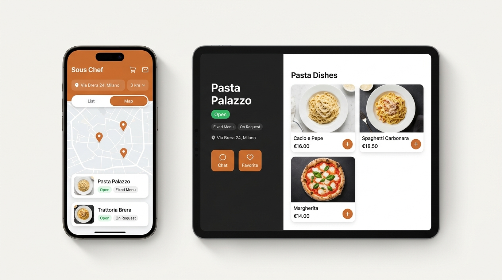
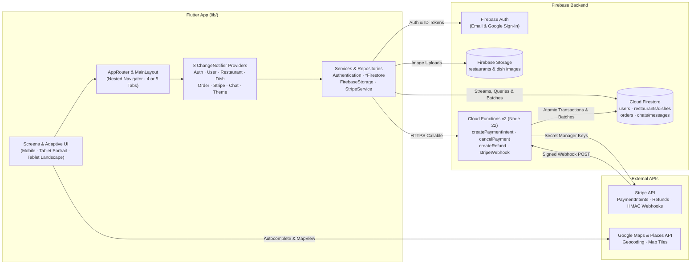
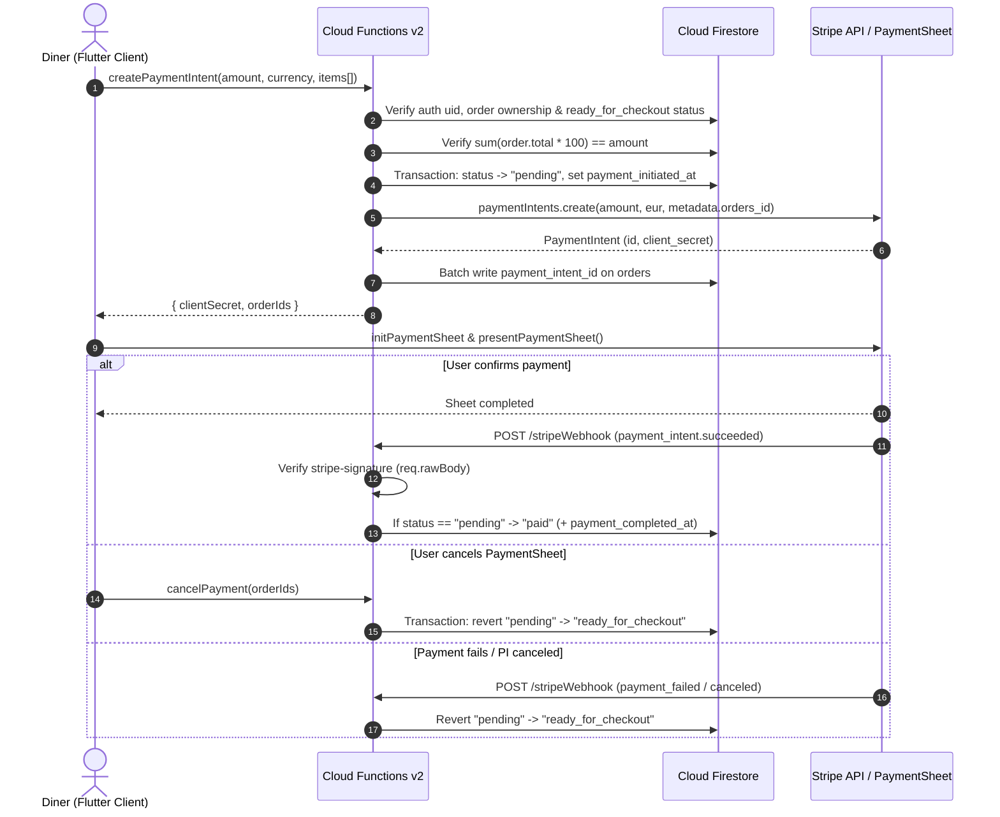
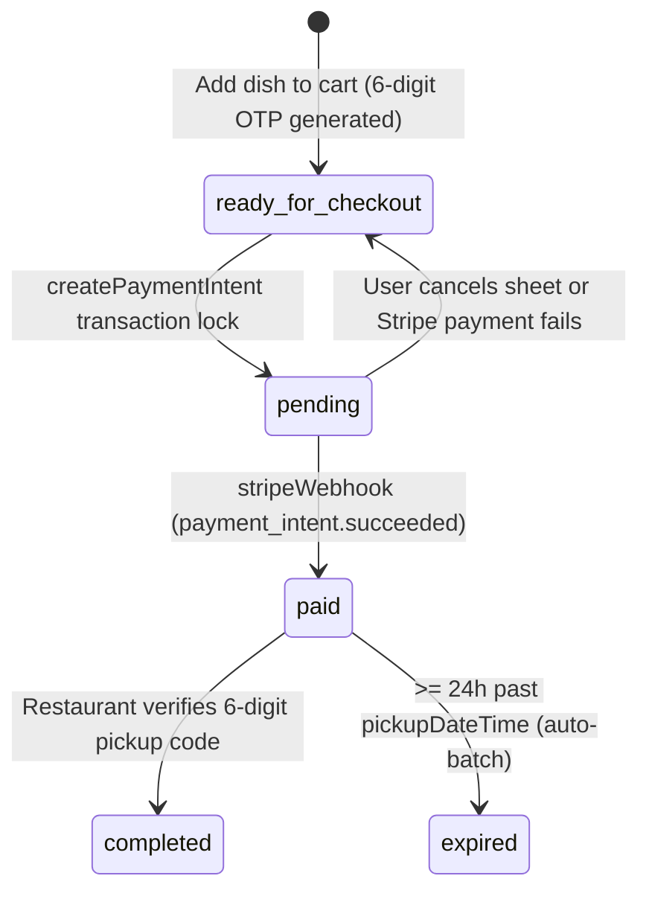

<div align="center">


<br />

<p>
  
  
  
  
  
</p>

**SousChef** is a cross-platform Flutter marketplace connecting local diners with neighborhood restaurants and chefs for scheduled pickup orders and private, custom-cooked dishes — powered by Firebase, Google Maps, and transactional Stripe checkout.

<p>
  <a href="#visual-tour">Visual Tour</a> &nbsp;&middot;&nbsp;
  <a href="#features">Features</a> &nbsp;&middot;&nbsp;
  <a href="#architecture">Architecture</a> &nbsp;&middot;&nbsp;
  <a href="#payment--order-pipeline">Payment Pipeline</a> &nbsp;&middot;&nbsp;
  <a href="#quick-start">Quick Start</a> &nbsp;&middot;&nbsp;
  <a href="#testing">Testing</a> &nbsp;&middot;&nbsp;
  <a href="#security--license">Security &amp; License</a>
</p>

</div>

---

## Visual Tour

<div align="center">
  
</div>

<br />

| 1 · Discover | 2 · Schedule | 3 · Checkout | 4 · Verify &amp; Chat |
| :--- | :--- | :--- | :--- |
| Search Italian addresses via Google Places, adjust your radius (`1 km+`), and browse nearby kitchens in **List** or **Map** view. | Pick from public **Fixed Menu** courses or private **On Request** dishes using a calendar constrained by `minForewarningDays`. | Items group into orders per `(restaurant, pickup slot)` and settle in EUR (`€`) through **Cloud Functions v2** + **Stripe PaymentSheet**. | Kitchens confirm handoff with a **6-digit pickup code** (`completed`) while diners &amp; chefs coordinate over **real-time 1:1 chat**. |

---

## Features

SousChef adapts navigation, permissions, and layouts across **two user roles** (`Customer` and `Restaurant Owner`) and **three responsive breakpoints** (`Mobile`, `Tablet Portrait`, and `Tablet Landscape` at `shortestSide >= 600dp`).

### For Diners
- **Authentication & Onboarding:** Email/password registration and login, Google Sign-In, password reset, and account deletion with recent-login verification.
- **Geolocated Discovery:** Address autocomplete (`Google Places`, Italy-scoped), distance slider (`3 km` default, `1 km` minimum), Haversine radius filtering, and custom orange map markers (`Google Maps`).
- **Menu & Bespoke Booking:** Filterable courses (`Appetizer` → `Drink`), cuisine tags, dish availability checks, and a forewarning-aware date/time picker.
- **Private *On-Request* Dishes:** Dishes created specifically for a diner's `@username` appear exclusively in that diner's *On Request* tab.
- **Grouped Cart & Order Tracking:** Orders auto-group by `(restaurantId, pickupDateTime)` down to the minute; active paid orders display pickup addresses and a 6-digit verification code, while completed orders move to **Past Orders**.
- **Favorites & Real-Time Chat:** Bookmark kitchens, message restaurant owners directly, track live unread badge counts, and switch between Light (`#F7F6F4` / `deepOrange`) and Dark (`#121212` / `#FF6B00`) themes.

### For Restaurant Owners
- **Dedicated Kitchen Tab:** Signing up as a chef/owner inserts a 5th **Restaurant** management tab into the bottom navigation bar (`MainLayout`).
- **Storefront Controls:** Toggle live `Open / Closed` status, rename restaurant, update address coordinates, upload a profile photo to Firebase Storage, and enable up to two service modes (`Fixed Menu`, `On Request`).
- **Menu & Special Dish CRUD:** Create, edit, toggle availability, and delete dishes with Storage-backed imagery; target custom dishes to a specific diner username (automatically synced if the diner updates their username).
- **Pickup Verification Queue:** Inspect incoming paid orders under **Received Orders** and validate handoff with the diner's 6-digit OTP (`VerificationCodeInput`); uncollected orders `>= 24h` past pickup automatically expire.

---

## Architecture

SousChef uses a layered **Provider + Service** architecture on the Flutter client paired with **Firebase** and serverless **Cloud Functions v2 (Node 22)** for trusted Stripe operations.



### Key Frontend Modules
| Layer | Location | Responsibility |
| :--- | :--- | :--- |
| **Entry & Routing** | [`lib/main.dart`](lib/main.dart), [`lib/app_router.dart`](lib/app_router.dart) | Initializes `.env`, Firebase, Stripe publishable key, `MultiProvider`, and route transitions (`/login`, `/signup`, `/main`, `/restaurant`, `/cart`, `/allChats`, `/chat`, `/account-settings`, `/past-orders`). |
| **State Management** | [`lib/providers/`](lib/providers) | Dependency-injected `ChangeNotifier`s (`AuthProvider`, `UserProvider`, `RestaurantProvider`, `DishProvider`, `OrderProvider`, `StripeProvider`, `ChatProvider`, `ThemeProvider`). |
| **Data & Services** | [`lib/services/`](lib/services) | Wraps Firebase Auth, Google Sign-In, Storage image validation (`jpg`, `jpeg`, `png`, `gif`, `webp`), Cloud Functions callables, and Firestore repositories (`lib/services/database/`). |
| **Responsive & Theme** | [`lib/services/orientation_manager.dart`](lib/services/orientation_manager.dart), [`lib/themes/`](lib/themes) | Locks phones (`< 600dp`) to portrait while enabling tablet portrait/landscape split-views (`50/50` Home Map+List, `1/3 + 2/3` Restaurant & Chat, `400px` master-detail Account). |

---

## Payment & Order Pipeline

All sensitive payment logic runs server-side in [`functions/`](functions/index.js) using **Google Cloud Secret Manager** (`STRIPE_SECRET_KEY`, `STRIPE_WEBHOOK_SECRET`), preventing client-side price tampering or premature order confirmation.



### Order Status Lifecycle


<details>
<summary><strong>Firestore Collections &amp; Storage Layout</strong></summary>

| Collection / Path | Key Fields &amp; Purpose |
| :--- | :--- |
| `users/{uid}` | `email`, `username`, `name`, `surname`, `phone`, `restaurant_id`, `favourites[]`, `chats[]`, `saved_address`, `latitude`, `longitude` |
| `restaurants/{rid}` | `name`, `address`, `is_open`, `restaurant_types[]` (`fixed_menu` \| `on_request`), `owner_id`, `location` (`GeoPoint`), `image_url` |
| `restaurants/{rid}/dishes/{did}` | `name`, `description`, `price`, `is_special`, `course`, `cuisine`, `min_forewarning_days`, `image`, `is_available`, `user_username`, `creation_time` |
| `orders/{oid}` | `user_id`, `username`, `restaurant_id`, `restaurant_name`, `restaurant_address`, `restaurant_location`, `pickup_date_time`, `verification_code`, `status`, `total`, `dishes[]`, `payment_intent_id` |
| `chats/{cid}` | `user1_id`, `user2_id`, `last_message`, `last_message_time` |
| `chats/{cid}/messages/{mid}` | `message`, `sender_id`, `receiver_id`, `timestamp`, `is_read` |
| **Firebase Storage** | `images/restaurants/{rid}/profile_image.png` &nbsp;&middot;&nbsp; `images/restaurants/{rid}/dishes/{did}.png` |

</details>

<details>
<summary><strong>Repository Structure</strong></summary>

```text
SousChef_DIMA/
├── lib/
│   ├── config/environment.dart        # Environment switcher (dev / test / production)
│   ├── models/                        # User, Restaurant, Dish, Order, Chat, Message
│   ├── providers/                     # 8 ChangeNotifier providers with DI support
│   ├── screens/                       # 14 responsive screens (Phone + Tablet layouts)
│   ├── services/                      # Auth, Storage, StripeService, OrientationManager, database/*
│   ├── themes/                        # light_mode, dark_mode, ThemeProvider
│   └── widgets/                       # Modular UI components per screen
├── functions/
│   ├── index.js                       # Cloud Functions v2 entrypoints + Secret Manager bindings
│   └── Stripe/                        # payment.js, cancelPayment.js, refund.js, webhook.js
├── test/                              # 72 unit/widget test files (1,817 tests) + mocks/helpers
├── integration_test/                  # 4 end-to-end Firebase test suites (12 flows)
├── docs/images/                       # README hero banner & app showcase visuals
├── .env.example                       # Client environment variable template
├── LICENSE                            # Apache License 2.0
└── SECURITY.md                        # Vulnerability disclosure & key-management guide
```

</details>

---

## Quick Start

### Prerequisites
- **Flutter SDK** (`^3.7.0`) & Dart SDK
- **Node.js 22** & **Firebase CLI** (`npm install -g firebase-tools`)
- A **Firebase** project (Auth, Firestore, Storage, Blaze plan for Cloud Functions v2)
- **Stripe** account (publishable key, secret key, webhook signing secret)
- **Google Maps Platform** API key (Maps SDK for Android/iOS + Places API)

### 1. Client Setup
```bash
git clone https://github.com/Frost40/SousChef_DIMA.git
cd SousChef_DIMA
flutter pub get
```

Create `.env` from the template and populate your keys (never commit `.env`):
```bash
cp .env.example .env
```
```env
STRIPE_PUBLISHABLE_KEY=pk_test_your_stripe_publishable_key_here
GOOGLE_MAPS_API_KEY=your_google_maps_api_key_here
```

Platform-specific Maps setup:
- **Android:** [`android/app/build.gradle.kts`](android/app/build.gradle.kts) automatically injects `GOOGLE_MAPS_API_KEY` from `.env` (or environment variables) into `AndroidManifest.xml`.
- **iOS:** Create `ios/Flutter/Secrets.xcconfig` (gitignored) with:
  ```xcconfig
  GOOGLE_MAPS_API_KEY = your_google_maps_api_key_here
  ```
- **Firebase:** Run `flutterfire configure` if pointing to your own Firebase project (`lib/firebase_options.dart`, `android/app/google-services.json`, `ios/Runner/GoogleService-Info.plist`).

### 2. Cloud Functions Backend Setup
```bash
cd functions
npm install
firebase functions:secrets:set STRIPE_SECRET_KEY
firebase functions:secrets:set STRIPE_WEBHOOK_SECRET
firebase deploy --only functions
```
Register the deployed `stripeWebhook` HTTPS URL in your Stripe Dashboard for `payment_intent.succeeded`, `payment_intent.payment_failed`, and `payment_intent.canceled` events.

### 3. Run the App
```bash
flutter run
```

---

## Testing

SousChef includes **1,817 unit and widget tests** (using `mocktail` and `fake_cloud_firestore`) plus **4 real-Firebase E2E integration suites**.

| Suite | Files | Cases | Scope | Command |
| :--- | :---: | :---: | :--- | :--- |
| **Models** | 6 | 391 | Firestore mapping, enums, edge cases | `flutter test test/models/` |
| **Providers** | 7 | 367 | State transitions, error handling, DI | `flutter test test/providers/` |
| **Services & DB** | 8 | 223 | Auth, Storage, Stripe, Firestore ops | `flutter test test/services/` |
| **Widgets & Screens** | 51 | 836 | Light/Dark themes, Phone/Tablet layouts | `flutter test test/widgets/ test/screens/` |
| **Integration (E2E)** | 4 | 12 | Real Auth, Firestore, Chat & Order flows | See below |

```bash
# Run full unit & widget suite (1,817 tests)
flutter test

# Generate coverage report
flutter test --coverage

# Lint Cloud Functions
npm --prefix functions run lint

# Run E2E integration tests with injected test credentials
flutter test integration_test/ \
  --dart-define=TEST_EMAIL=your-test-user@example.com \
  --dart-define=TEST_PASSWORD=your-test-password \
  --dart-define=TEST_OWNER_EMAIL=your-test-owner@example.com \
  --dart-define=TEST_OWNER_PASSWORD=your-owner-password
```

---

## Security & License

- **Security Guidelines:** See [SECURITY.md](SECURITY.md) for vulnerability reporting, API key restrictions, Firebase App Check / Firestore Rules recommendations, and secret isolation practices.
- **License:** Distributed under the **Apache License, Version 2.0** — see [LICENSE](LICENSE) for full terms, including attribution requirements, patent grants, and liability disclaimers.
